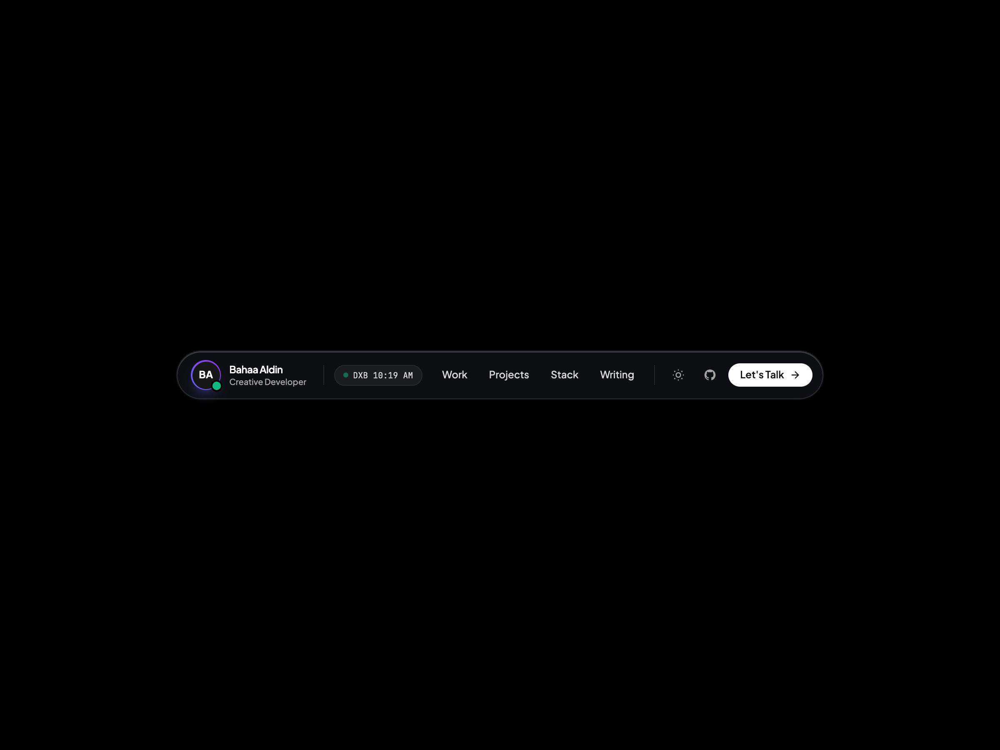

# 🏝️ Liquid Glass Floating Island Navbar

> Ultra-refined, distraction-free floating island dock on a minimal canvas with real-time Dubai clock, magnetic sliding tab capsule, and dark/light mode.

[](https://IBahaaaldin.github.io/navbar-floating-island/)
[](https://IBahaaaldin.github.io/navbar-floating-island/)

---

## 🌐 Visual Previews

| Desktop Showcase (1200x900) | Mobile Showcase (390x844) |
| :---: | :---: |
|  |  |

*(Includes full interaction videos: `video-desktop.mp4` and `video-mobile.mp4`)*

---

## ✨ Features & Micro-Interactions

- **Clean Minimal Canvas**: Pure black (`#000000`) or pure crisp white (`#ffffff`) canvas with zero clutter.
- **Dead-Center Ergonomics**: Placed dead-center both horizontally and vertically across desktop and mobile.
- **Specular Liquid Glass**: Dual-layer backdrop blur with 190% saturation and inset specular highlights.
- **Magnetic Sliding Capsule**: Physics-based hover pill that smoothly glides behind navigation tabs.
- **Live Dubai Clock**: Real-time ticking Dubai time pill (`DXB 10:15 AM`) with pulsing green status dot.
- **Zero Text Wrapping**: Strict `whitespace-nowrap` guarantees titles, names, and buttons stay unbroken.
- **Instant Theme Switcher**: Sun ☀️ / Moon 🌙 button built directly into the navbar to toggle dark/light theme.
- **Responsive Mobile Drawer**: Native slide-down menu with icons, live time, social links, and CTA button.
- **Zero Build Step**: 100% self-contained HTML5 + Tailwind CSS CDN + inline SVGs.

---

## 📁 Repository Structure

```text
├── index.html              # Standalone production navbar component
├── screenshot-desktop.png  # Desktop visual preview (1200x900)
├── video-desktop.mp4       # Desktop interaction recording (MP4)
├── screenshot-mobile.png   # Mobile visual preview (390x844)
├── video-mobile.mp4        # Mobile interaction recording (MP4)
├── record.js               # Playwright automation script used to record all 4 assets
├── README.md               # Documentation & setup notes
└── CAPTION.md              # Ready-to-copy Instagram caption for @ibahaaaldincoding
```

---

## 🚀 Quick Start

### 1. View Locally
Simply clone and open `index.html` in your browser:
```bash
git clone https://github.com/IBahaaaldin/navbar-floating-island.git
cd navbar-floating-island
open index.html
```

### 2. Re-record Assets
To re-record desktop & mobile screenshots and videos:
```bash
node record.js
```

---

## 👤 Author & Connect

**Bahaa Mohammed**
Creative Developer & Software Engineer
- 📸 **Instagram**: [@ibahaaaldincoding](https://www.instagram.com/ibahaaaldincoding)
- 🐙 **GitHub**: [@IBahaaaldin](https://github.com/IBahaaaldin)
- 💼 **LinkedIn**: [Bahaa Mohammed](https://www.linkedin.com/in/bahaa-mohammed-371259369)
- 📧 **Email**: bahaam.coding@gmail.com

---

Part of the **[Ready-UIs](https://github.com/IBahaaaldin/IBahaaaldin/tree/main/Ready-UIs)** design collection.
